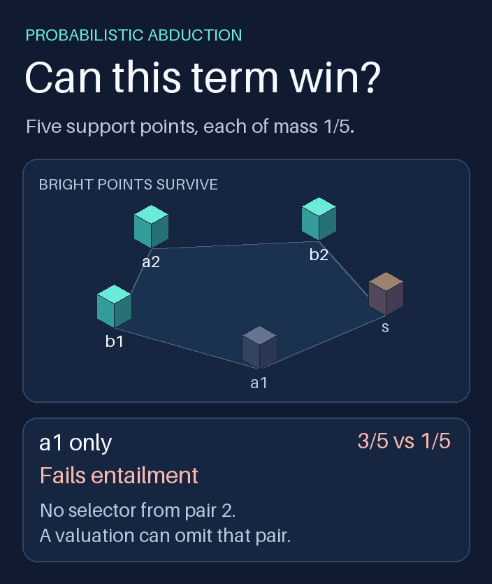

# Recognizing preferred explanations in probabilistic abduction

  

Recognizing a preferred explanation is Π₂ᴾ-complete in the propositional probabilistic abduction model of Flaminio, Inoue and Kozhemiachenko. Their Theorem 11(2) supplies membership. This note proves hardness with one assessed event and, by a separate construction, with an explicitly listed distribution and a tautological theory.

[Read the paper](paper/manuscript.pdf) · [LaTeX source](paper/manuscript.tex) · [Proof outline](proof/PROBLEM_AND_PROOF.md) · [Run the replay](REPRODUCIBILITY.md)

## How a selector term defeats the fallback

The five points have mass 1/5 each. Selecting a₁ leaves mass 3/5 but fails entailment because the second pair can be absent outside the support. Selecting a₁ ∧ b₂ leaves 2/5 and entails the observation, beating the fallback s at 1/5. Adding selectors can yield a valid explanation that ties rather than wins.

[Download the offline explorer](https://raw.githubusercontent.com/DannyExperiments/preferred-probabilistic-explanations/refs/tags/v1.0.0/visualization/support-comparison-explorer.zip), extract it, and open `index.html`. Toggle four selectors and drag to rotate the support points. [Figure guide](visualization/README.md)

## Scope and prior result

Definition 24 requires classical entailment plus positive mass jointly with the theory. Preference compares unconditional term probabilities and permits a different coherent measure for each rival. The listed-support construction gives a unique measure and uses entailment across all valuations. The [explicit-support supplement](proof/explicit-support-supplement.zip?raw=1) also treats constant-size support.

[Original question](https://proceedings.kr.org/2026/30/kr2026-0030-flaminio-et-al.pdf#page=10) · [Prior upper bound](https://proceedings.kr.org/2026/30/kr2026-0030-flaminio-et-al.pdf#page=9) · [Pinned Q800](https://github.com/10m-u/open-problems-catalog/blob/ca8d4d44ba3db527f19f28928c240168f545ecfe/problems/mathematics/mathematical-statistics.md#q800)

[Mathematical audit](audits/public_safe_reports/MATHEMATICAL_AUDIT.md) · [Literature audit](audits/public_safe_reports/LITERATURE_AUDIT.md) · [Scope](CLAIM_SCOPE_AND_LIMITATIONS.md) · [AI disclosure](AI_DISCLOSURE.md) · [Status](STATUS.md)

[Release v1.0.0](https://github.com/DannyExperiments/preferred-probabilistic-explanations/releases/tag/v1.0.0) · [Version DOI](https://doi.org/10.5281/zenodo.24572562) · [Citation](CITATION.cff)

## Lean verification

A heavier term with a supported theory witness and entailment throughout the theory exists exactly when a heavier subset of the support has such a witness and its common-literal closure entails the observation throughout the theory. The weight threshold is modeled by an upward-closed predicate. The support-size complexity bounds and hardness constructions are proved in the paper. [Lean source and replay](formalization/README.md)
